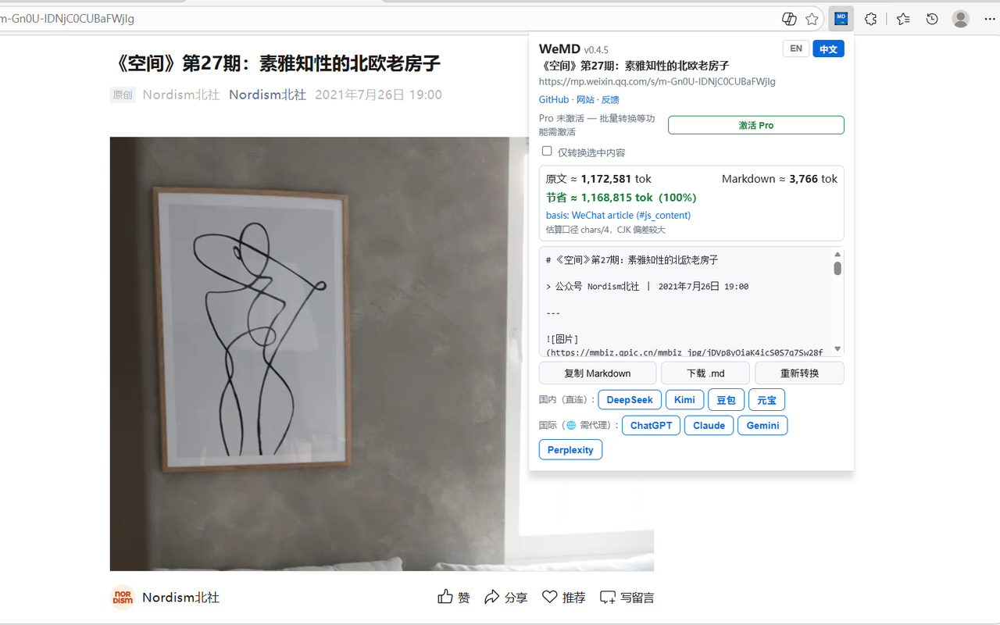
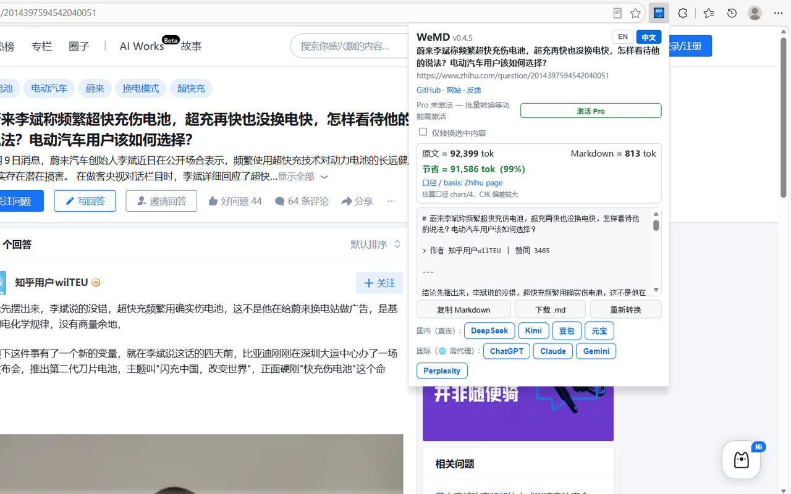
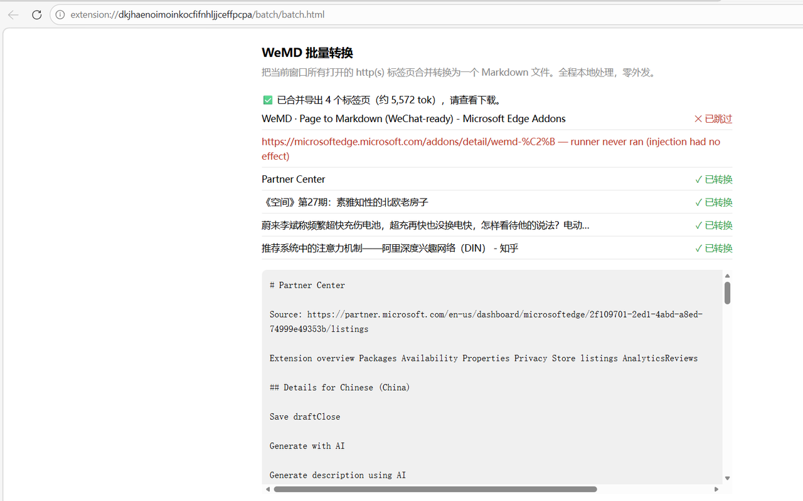

# WeMD · Page to Markdown (WeChat-ready)

[中文说明 →](README.zh-CN.md)


> Turn any web page — including WeChat Official Account articles — into clean, LLM-ready Markdown, 100% inside your browser, with the token savings **quantified** before you paste.

**Version 0.4.7** · MV3 · No account · No telemetry

| Browser | Status | Install |
|---|---|---|
| Firefox | 🟢 **Live** (v0.4.7) | [Firefox Add-ons](https://addons.mozilla.org/firefox/addon/wemd-page-to-markdown/) |
| Edge | 🟢 **Live** (v0.4.7) | [Edge Add-ons](https://microsoftedge.microsoft.com/addons/detail/wemd-%C2%B7-page-to-markdown-/genfncfahlncmphhoaoomepbdooeiajj) |
| Chrome | 🟢 **Live** (v0.4.7) | [Chrome Web Store](https://chromewebstore.google.com/detail/wemd-%C2%B7-page-to-markdown-w/aiijpaddpkdppaabanaafiffoiidamgi) |

## Why / 为什么

Most "save as Markdown" tools fetch the page from a server — which fails on logins, paywalls, SPAs and WeChat's 3 MB JS shells. WeMD converts **in your browser, on the live DOM**, and tells you exactly what it saved:

| Page | Raw tokens | WeMD tokens | Saved |
|---|---|---|---|
| WeChat Official Account article 公众号文章 | 1,172,581 | 3,766 | **−99.7%** |
| WeChat article (another sample) 公众号文章 | 1,117,393 | 905 | **−100%** |
| python.org | 13,245 | 746 | −95% |

*(chars/4 heuristic, shown honestly in the UI as an estimate.)*

## What it does / 功能

**Free · 免费版**

- **One-click conversion** — full page or selection; headings, lists, tables, links and fenced code blocks (with language tags) preserved
- **WeChat-specific extraction** — real title, account name, publish time, `#js_content` body, lazy-loaded `data-src` image repair, promo tails and hidden template nodes trimmed
- **Shadow-DOM aware** — content rendered inside web components is captured too
- **Token savings panel** — raw vs Markdown vs saved, before you paste into any AI chat
- **Send to AI** — one click opens DeepSeek / Kimi / Doubao / Yuanbao / ChatGPT / Claude / Gemini / Perplexity with the Markdown ready to paste
- **Context menu + hotkey** — right-click download, `Alt+Shift+M` popup
- **English & Chinese UI**

**Pro · 付费版**

- **Batch convert** — merge every open http(s) tab in the window into one Markdown file
- **Image bundling** — export tabs and their images into one folder with rewritten local links
- **Front-matter templates** — `{{title}} {{url}} {{site}} {{author}} {{account}} {{date}}` rendered on every export
- **Pricing** — $3.99/month · $29/year · $59 lifetime (early users lock lifetime)

## Screenshots / 截图

| | |
|---|---|
|  |  |
|  | |

## Privacy / 隐私

**The extension makes zero network requests.** No account, no telemetry, no analytics, no cloud. Conversion happens in your browser and dies with the popup unless you save it. The only network call is Pro license activation, which sends just your license key and email — never any page content.

Full policy: [PRIVACY.md](PRIVACY.md) · [Privacy Policy (web)](https://wemd.zyx.pink/privacy.html)

## Install from source / 从源码安装

```bash
git clone https://github.com/stwhwing/wemd-extension.git
```

1. Chrome/Edge → `chrome://extensions` (or `edge://extensions`) → enable **Developer mode**
2. **Load unpacked** → select the cloned folder (repo root, where `manifest.json` lives)
3. Open any page → click the WeMD icon, or press `Alt+Shift+M`

## License / 许可

Copyright (c) 2026 Wing (stwhwing). **All Rights Reserved.** Source is public for security audit and research; see [LICENSE](LICENSE). Bundled libraries keep their own licenses: Mozilla Readability (BSD-3) · Turndown (MIT).

## Contact / 联系

wing@zyx.pink · [GitHub Issues](https://github.com/stwhwing/wemd-extension/issues) · Landing page: [wemd.zyx.pink](https://wemd.zyx.pink/)

Agent-side sibling project: [markitdown-skill](https://github.com/stwhwing/markitdown-skill) — the same "clean Markdown + honest token math" as a CLI skill for AI agents.
