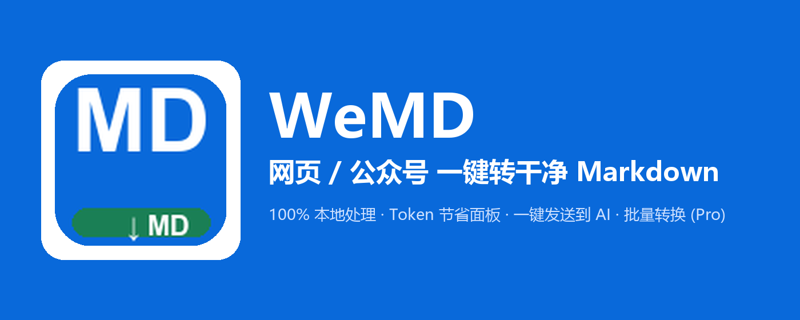

# WeMD · 网页/公众号转 Markdown

[English README →](README.md)

> 把任意网页——包括微信公众号文章——一键转换成干净、适合大模型输入的 Markdown，全部在你的浏览器本地完成，并在粘贴前**量化显示 token 节省**。

**版本 0.4.7** · MV3 · 无账号 · 无遥测



| 浏览器 | 状态 | 安装 |
|---|---|---|
| Firefox | 🟢 已上架 | [Firefox Add-ons](https://addons.mozilla.org/firefox/addon/wemd-page-to-markdown/) |
| Edge | 🟢 已上架（v0.4.7） | [Edge Add-ons](https://microsoftedge.microsoft.com/addons/detail/wemd-%C2%B7-page-to-markdown-/genfncfahlncmphhoaoomepbdooeiajj) |
| Chrome | 🟢 已上架（v0.4.7） | [Chrome 应用商店](https://chromewebstore.google.com/detail/wemd-%C2%B7-page-to-markdown-w/aiijpaddpkdppaabanaafiffoiidamgi) |

## 为什么做它 / Why

大多数"存为 Markdown"工具在**服务端**抓取页面——登录后的文档、付费墙、SPA 空壳、微信公众号的 3 MB JS 壳统统失败。WeMD 在**你的浏览器里、渲染后的真实 DOM 上**转换，并告诉你省了多少：

| 页面 | 原始 token | WeMD | 节省 |
|---|---|---|---|
| 微信公众号文章 | 1,172,581 | 3,766 | **−99.7%** |
| 微信公众号文章（另一样本） | 1,117,393 | 905 | **−100%** |
| python.org | 13,245 | 746 | −95% |

*（chars/4 启发式估算，UI 中如实标注。）*

## 功能

**免费版**

- **一键转换**——整页或选中内容；标题、列表、表格、链接与带语言标注的围栏代码块完整保留
- **微信公众号专项提取**——真实标题、公众号名、发布时间、`#js_content` 正文、懒加载 `data-src` 图片修复，并自动清理推广尾与隐藏模板节点
- **支持 Shadow DOM**——网页组件（Web Components）内渲染的内容同样可提取
- **Token 节省面板**——粘贴给任何 AI 前，先看到省了多少
- **发送到 AI**——一键打开 DeepSeek / Kimi / 豆包 / 元宝 / ChatGPT / Claude / Gemini / Perplexity，Markdown 已就绪
- **右键菜单 + 快捷键**——右键下载整页/选区，`Alt+Shift+M` 打开弹窗
- **中英文界面**

**Pro**

- **批量转换**——把当前窗口所有打开的 http(s) 标签页合并为一个 Markdown 文件
- **图片打包**——标签页与图片导出到同一文件夹，图片链接改写为本地相对路径
- **Front-matter 模板**——`{{title}} {{url}} {{site}} {{author}} {{account}} {{date}}` 随每次导出渲染
- **定价**——$3.99/月 · $29/年 · $59 终身买断（早期用户锁定买断价）

## 隐私

**扩展自身零网络请求。** 无账号、无遥测、无统计、无云端。转换在你的浏览器内完成，弹窗关闭即消失，除非你主动保存。唯一一次联网是 Pro 激活，只发送许可证密钥与邮箱——绝不发送页面内容。

完整政策：[PRIVACY.md](PRIVACY.md) · [隐私政策（网页版）](https://wemd.zyx.pink/privacy.html)

## 从源码安装

```bash
git clone https://github.com/stwhwing/wemd-extension.git
```

1. Chrome/Edge → `chrome://extensions`（或 `edge://extensions`）→ 开启**开发人员模式**
2. **加载解压缩的扩展** → 选择克隆下来的文件夹（仓库根目录，`manifest.json` 所在处）
3. 打开任意网页 → 点 WeMD 图标，或按 `Alt+Shift+M`

## 许可

Copyright (c) 2026 Wing (stwhwing)。**保留所有权利。** 源码公开仅用于安全审计与研究，详见 [LICENSE](LICENSE)。内置第三方库保留各自许可：Mozilla Readability（BSD-3）· Turndown（MIT）。

## 联系

wing@zyx.pink · [GitHub Issues](https://github.com/stwhwing/wemd-extension/issues) · 官网：[wemd.zyx.pink](https://wemd.zyx.pink/)

Agent 侧姊妹项目：[markitdown-skill](https://github.com/stwhwing/markitdown-skill)——同样的「干净 Markdown + 诚实 token 数学」，做成 AI Agent 的 CLI 技能。
